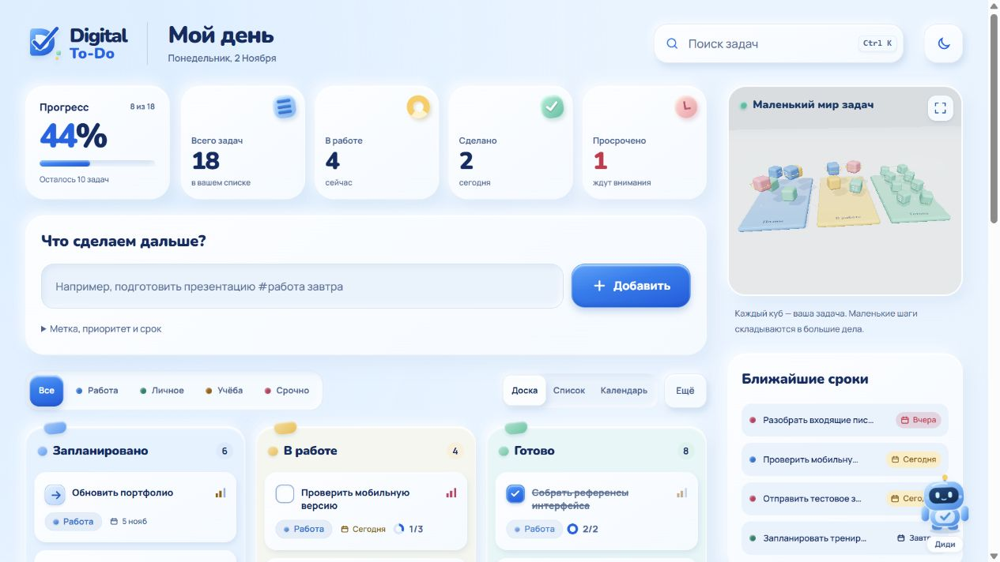
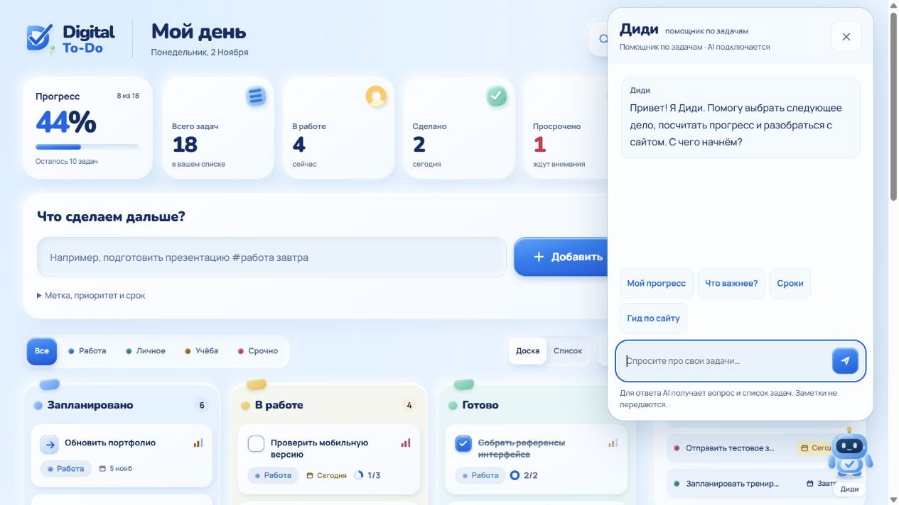
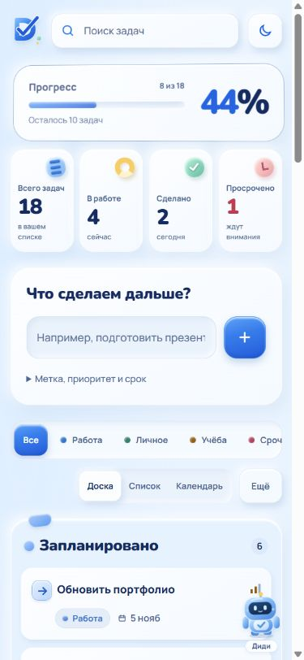

# Digital To-Do — ваш день в порядке

Список задач на HTML, CSS и JavaScript (ES-модули, без сборки). Небесно-голубой интерфейс, канбан, список и календарь, статистика, небольшой 3D-обзор и живой помощник. На телефоне 3D скрыт и не загружается.

**Сайт:** https://supremegoogle.github.io/The-Digital/ · **Репозиторий:** https://github.com/SupremeGoogle/The-Digital · **Промо-ролик:** [`promo-video/renders/digital-todo-promo.mp4`](promo-video/renders/digital-todo-promo.mp4)

> Канбан с drag & drop · умный ввод · список и календарь · Telegram-напоминания · помощник Диди (AI через Router AI) · 3D-обзор · дашборд · тёмная тема · заставка · демо-данные



[Полный экран с доской и статистикой](docs/screenshot.jpg)

[Календарь задач](docs/calendar.jpg)

| Чат Диди — локальный запуск с RouterAI | Мобильная версия |
| --- | --- |
|  |  |

## Основные функции из задания

- **Добавление задач** — поле ввода, Enter или кнопка «Добавить».
- **Работа со статусами** — стрелка в «Запланировано» берёт задачу в работу; галочка в «В работе» завершает её. Также доступны перенос между колонками и выбор статуса в деталях.
- **Удаление** — перетащить карточку в корзину, кнопка в карточке задачи, клавиша Delete или «Очистить готовые». Удаление можно отменить (кнопка или Ctrl+Z).
- **Сохранение** — всё хранится в `localStorage`, переживает перезагрузку и синхронизируется между вкладками.

## Что сверху

**3D-обзор (Three.js).** Небольшая правая панель с матовыми кубами на голубой, жёлтой и мятной платформах. Единственная кнопка разворачивает обзор; Esc сворачивает. Названия задач видны только в развёрнутом режиме. Кубы отражают реальные задачи, нажатием открываются детали, перенос меняет статус. Мягкое освещение, тени и ненавязчивое движение; при reduced motion фоновая анимация отключена. На экранах до 700 px блок скрыт, Three.js не загружается. Главная рабочая область отдана задачам.

**Канбан с drag & drop.** Колонки «Запланировано / В работе / Готово», перенос между колонками и внутри колонки с плавной анимацией соседей, на телефоне — удержанием пальца. Пустая область под короткой колонкой тоже принимает задачи. Корзина срабатывает после короткого удержания над ней, чтобы не удалить случайно. С клавиатуры: Alt + стрелки двигают карточку, пробел запускает или завершает задачу, Enter открывает детали.

**Дашборд.** Прогресс, KPI с 3D-наклоном и бликом, активность за неделю, распределение по меткам, ближайшие сроки и просрочки.

**Карточка задачи.** Боковая панель: название, статус, метка, приоритет, срок, подзадачи с прогрессом, заметки.

**Умный ввод.** `Сдать отчёт #работа ! завтра` сам ставит метку, высокий приоритет и срок. Понимает `#метка`, `!` и `~` (приоритет), `сегодня`, `завтра`, `послезавтра`, `в пт`, `через 3 дня`, `25.12`.

**Календарь.** Переключатель «Доска / Список / Календарь», месяцы с понедельника, задачи по срокам и подробная повестка выбранного дня. Плюс у даты заполняет срок новой задачи. Поиск и метки работают в календаре; на телефоне остаётся компактная сетка и список дел дня.

**Прочее.** Поиск (Ctrl+K), фильтр по меткам, светлая и тёмная тема, адаптивная вёрстка, `prefers-reduced-motion`, aria-разметка.

**Диди.** Оригинальный голубой робот моргает, шагает, следит взглядом за курсором, машет рукой и радуется выполнению. Коротко реагирует на действия с задачами, не открывая чат и не отправляя фоновых AI-запросов. Без API считает актуальный прогресс, находит просрочки и важные дела, показывает задачи на сегодня/завтра и проводит по интерфейсу кнопками гида. Это локальные правила по данным браузера, а не языковая модель. Системное ограничение анимации учитывается автоматически.

**Потоковый чат.** Ответ модели передаётся через SSE и появляется по мере получения текста. Есть индикатор ожидания, курсор и кнопка остановки; при недоступности API используются локальные ответы. Проверка семи реальных диалогов выявила неточности с датами выполнения; системный промпт уточнён. [Отчёт проверки](docs/assistant-qa.md).

**Telegram-напоминания.** В меню «Ещё» — подключение личного чата через одноразовую ссылку, выбор задач и точного времени. Сервер продолжает отправлять напоминания при закрытом сайте. Выполненные и удалённые задачи снимаются при следующей синхронизации браузера. Для публичного запуска нужны сервер и токен бота; в GitHub Pages без настроенного API функция показывает отключённое состояние. [Настройка Telegram для Claude Code](docs/TELEGRAM-SETUP.md).

**Демо-данные.** Доступны 18 примеров со сроками, подзадачами и активностью за неделю. В меню «Ещё → Добавить примеры» можно дополнить текущий список без удаления своих записей и без дублей. У примеров есть соответствующая отметка в заметках.

**Бренд и загрузка.** Собственный знак D с выступающей галочкой и цифровыми пикселями. Заставка показывает логотип 2,3 секунды и плавно открывает сайт; её можно пропустить действием. 3D запускается после заставки, чтобы не мешать прорисовке галочки. Независимый предел — 3 секунды; при reduced motion заставка отключена. Добавление и завершение задач сопровождаются короткими анимациями и частицами с ограниченным временем жизни.

## Подключение AI

На GitHub Pages публичный AI-endpoint пока не задан: доступен локальный аналитический помощник. В локальной разработке интерфейс автоматически обращается к `http://127.0.0.1:8787/api/assistant`, если такой сервер запущен. Ключ Router AI, потоковые ответы модели и Telegram-напоминания проверены локально. Публичный сервер пока не развёрнут, поэтому на GitHub Pages AI-чат и Telegram-бот выключены, а помощник работает в локальном режиме.

В `server/` подготовлен Node.js-адаптер для OpenAI-совместимого Chat Completions API. Ключ хранится только на сервере, контекст ограничен названиями/статусами/сроками/приоритетами, заметки не передаются. Есть ограничения запросов и таймаут. GitHub Pages обслуживает статический интерфейс; сервер подключается публичным HTTPS-адресом в метатеге `assistant-endpoint`.

[Инструкция настройки и готовое задание для Claude Code](docs/CLAUDE-DEPLOY-ASSISTANT.md) содержит плейсхолдеры SSH/домена и безопасного хранения ключей. Провайдер — RouterAI, база `https://routerai.ru/api/v1`. Модель задаётся переменной `AI_MODEL`; текущий локальный стриминг проверен с `openai/gpt-4.1-mini`. Секреты не включаются в репозиторий. Подключение к личному Telegram-чату пользователь подтверждает самостоятельно.

## Где хранятся данные

| Данные | Место хранения |
| --- | --- |
| Задачи, статусы, метки, сроки, приоритеты, заметки и подзадачи | `localStorage` браузера, ключ `taskflow.tasks.v2` |
| Светлая/тёмная тема | `localStorage`, ключ `taskflow.sky.theme` |
| Вид «Доска/Список/Календарь» | `localStorage`, ключ `digitaltodo.layout` |
| Признак первого наполнения примерами | `localStorage`, ключ `digitaltodo.examples.v1` |
| Выбранные Telegram-напоминания и ключ браузерной сессии | `localStorage`, ключи `digitaltodo.telegram.reminders` и `digitaltodo.telegram.session` |
| Текущая переписка с Диди и отмена удаления | В памяти открытой страницы; после обновления сбрасываются |
| Ключ RouterAI | Только окружение серверного процесса / игнорируемый `server/.env`; в браузер и Git не попадает |
| Токен Telegram-бота | Только серверное окружение `TELEGRAM_BOT_TOKEN` |
| Привязка Telegram-чата и расписание выбранных напоминаний | Приватный JSON-файл на сервере вне checkout, путь `REMINDERS_DB`; ключ сессии хранится как SHA-256-хеш |

База данных и аккаунт для основного списка задач не требуются. Задачи сохраняются после обновления и синхронизируются между вкладками одного браузера. Между разными браузерами и устройствами синхронизации нет; очистка данных сайта удалит локальный список. При включённых Telegram-уведомлениях сервер хранит только явно выбранные названия и время напоминаний вместе с привязкой чата. Изменения, сделанные при закрытом сайте или без связи, попадут в расписание после синхронизации.

При обращении к нейросетевой модели сервер получает вопрос, короткую историю и ограниченный контекст задач; заметки не отправляются. Серверный адаптер не записывает задачи и переписку в базу данных и не меняет задачи по ответу модели.

## Запуск

ES-модули не работают с `file://`, поэтому нужен любой локальный сервер:

```bash
python -m http.server 5174
```

и открыть http://localhost:5174

AI-чат и Telegram-напоминания (необязательно, Node.js 20.12+): скопировать `server/.env.example` в `server/.env`, вписать ключ Router AI и токен бота, затем

```bash
npm start --prefix server
```

Сайт на localhost сам найдёт сервер на `127.0.0.1:8787`.

## Структура

```
index.html        разметка
css/style.css     стили, темы, анимации
css/sky.css       материалы и компоновка нового интерфейса
css/intro.css     логотип и экран загрузки
css/assistant.css персонаж и чат
css/task-effects.css  анимации добавления и завершения
css/calendar.css  календарь задач
css/reminders.css Telegram-настройки
js/app.js         связывает всё вместе, ввод, фильтры, горячие клавиши
js/store.js       состояние, localStorage, миграция, демо-данные
js/parse.js       умный ввод и сроки
js/board.js       канбан и drag & drop
js/scene3d.js     3D-сцена на Three.js
js/dashboard.js   прогресс, KPI, графики
js/drawer.js      панель задачи
js/intro.js       короткая безопасная заставка
js/assistant.js   аналитика, чат и гид
js/assistant-stream.js  чтение потокового ответа
js/task-effects.js  ограниченные по времени эффекты задач
js/calendar.js    календарь и выбранный день
js/reminders.js   подключение Telegram и расписание
server/           серверный AI-адаптер и тесты
server/telegram.mjs  привязка Telegram и планировщик
docs/CLAUDE-DEPLOY-ASSISTANT.md  подключение сервера
docs/TELEGRAM-SETUP.md  настройка Telegram-бота
docs/REVIEWER-MESSAGE.md  сообщение для проверяющего
promo-video/      промо-ролик (бонус)
```

## Промо-ролик (бонус)

Сверх задания я сделал короткий промо-ролик продукта (45 секунд, русская озвучка, реальный интерфейс сайта): [`promo-video/renders/digital-todo-promo.mp4`](promo-video/renders/digital-todo-promo.mp4).

## AI-инструменты

Первая версия создана с помощью **Claude Code**. Переработка дизайна, бренд Digital To-Do, новая компоновка, демо-данные и помощник выполнены с помощью **OpenAI Codex**. Визуальные концепты исследовались через imagegen, финальный интерфейс реализован кодом по выбранному референсу. Код и ассеты SmartPal не переносились; персонаж создан для этого проекта.

Проверены в браузере: создание, отметка, удаление и отмена, перенос мышью и клавиатурой, заметки/подзадачи, сохранение после обновления, поиск, виды доска/список, мобильная компоновка и локальные ответы помощника.

Проверки серверного адаптера и локальной аналитики:

```bash
npm test --prefix server
```
