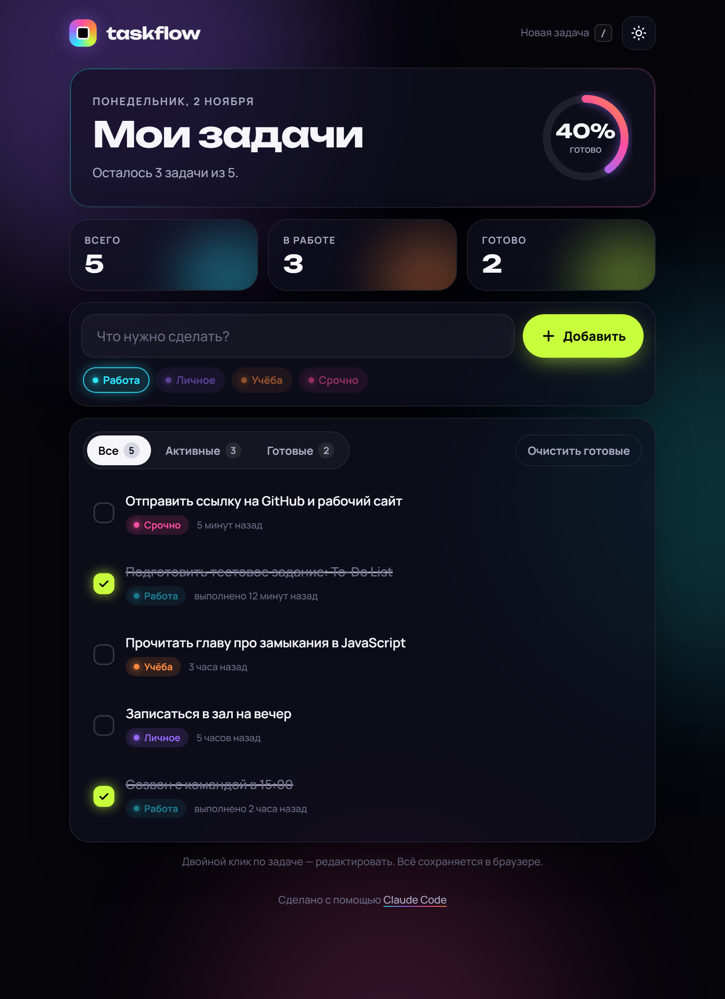

# taskflow — список задач

Простой To-Do List на чистом HTML, CSS и JavaScript, без фреймворков и сборки.

**Рабочий сайт:** https://supremegoogle.github.io/The-Digital/



## Что умеет

- **Добавление задач** — поле ввода, Enter или кнопка «Добавить». У задачи есть метка: Работа, Личное, Учёба, Срочно.
- **Отметка выполненных** — чекбокс, зачёркивание и прогресс в кольце сверху.
- **Удаление** — кнопка-корзина у задачи и «Очистить готовые». Удаление можно отменить в течение 5 секунд (кнопка или Ctrl+Z).
- **Сохранение** — задачи хранятся в `localStorage`, переживают обновление страницы и синхронизируются между вкладками.

Дополнительно: фильтры «Все / Активные / Готовые», редактирование двойным кликом, светлая и тёмная тема, клавиша `/` для быстрого ввода, адаптивная вёрстка для телефона, учёт `prefers-reduced-motion`.

## Запуск

Достаточно открыть `index.html` в браузере. Или поднять локальный сервер:

```bash
python -m http.server 5174
```

## Структура

```
index.html    разметка и шаблон задачи
style.css     стили, темы, анимации
app.js        логика: состояние, отрисовка, localStorage
favicon.svg   иконка
```

## AI-инструменты

Проект сделан с помощью **Claude Code** (Anthropic): он написал код, проверил все сценарии в браузере (добавление, отметка, удаление и отмена, перезагрузка страницы, мобильная версия, светлая тема) и опубликовал сайт на GitHub Pages. Визуальный стиль — тёмный интерфейс с неоновыми акцентами и «стеклянными» карточками — задан по моему референсу.
